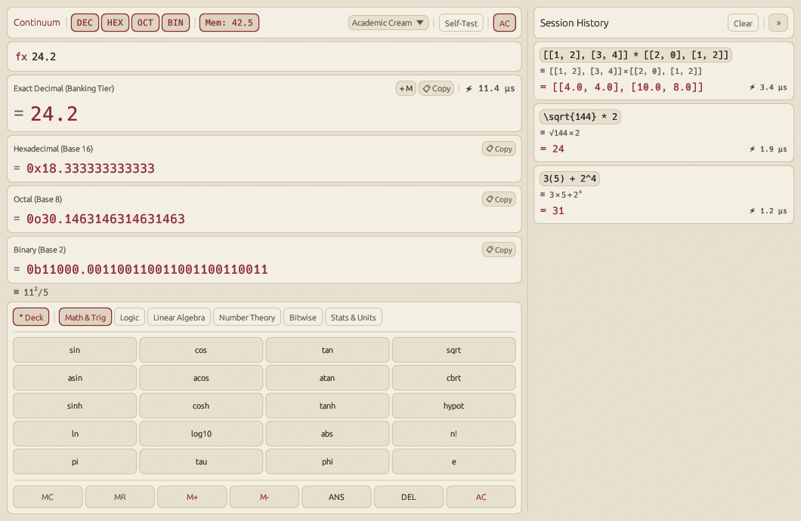
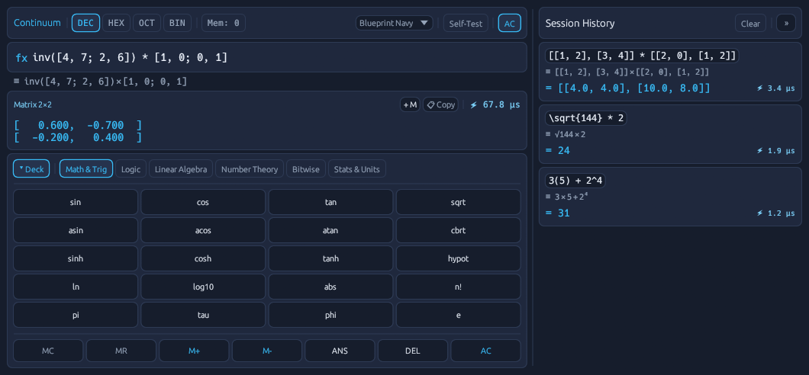
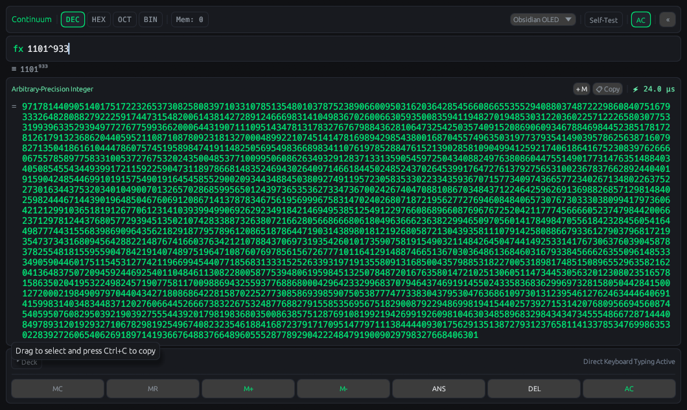

# ✨ Continuum

🏎️ Exact Math. Instant Answers. Zero Compromise.

By **gtaking** **`<ahkscriptlerim>`** 🚀 `2026 I` 📅

---

## 💡 Why Continuum Exists

Most calculators force an ugly trade-off: standard desktop calculators choke on `0.1 + 0.2`, while heavy algebra suites take seconds just to boot.

**Continuum** opens in milliseconds ⚡, answers before your finger leaves the key ⌨️, and refuses to round away a single bit of truth 🎯.

---

## 🏆 Signature Capabilities

### 1. 🏦 Zero Binary Drift (Banking-Tier Decimals)
- **Exact Banking Decimals** — `0.1 + 0.2` equals `0.3`, never `0.30000000000000004`.
- **Prime-Factorized Equivalence Lens** — Automatically reveals prime-power rational ratios underneath decimal answers (`24.2 ≡ 11²/5`, `0.000006 ≡ 3/(5×10⁵)`, `109.78 ≡ 11×499/(2×5²)`).
- **Exact Root Extraction** — `sqrt(0.09) = 0.3` and `cbrt(0.008) = 0.2` stay 100% decimal-exact.
- 💧 **Engineering Droplet:** Powered by a zero-float `i128` base-10 scaled mantissa engine with 28 guard digits and Banker's half-to-even rounding.

### 2. 🔢 Million-Digit Powerhouse
- **Arbitrary-Precision Integers** — Effortlessly compute `10000!`, `fib(20000)`, or million-bit powers.
- **Instant Input Wall** — Type fast through `9999^9999 + 1` without a single dropped frame; stale work aborts in microseconds.
- **Prime Factor Decomposition** — Factorizes 64-bit integers into prime powers on the fly (`2⁵ × 3² × 11⁴`).
- 💧 **Engineering Droplet:** Scales automatically across 4 tiers: inline stack `u64` limbs → `BMI2/ADX` Comba → multi-core Rayon Karatsuba → 64-bit Barrett 2-Prime + OpenCL GPU Number-Theoretic Transform (`NTT`).

### 3. 🎛️ Four Bases Simultaneously (`DEC` · `HEX` · `OCT` · `BIN`)
- **Independent Base Toggles** — View `DEC`, `HEX`, `OCT`, and `BIN` together in any combination (`≥ 1` active).
- **True Fractional Radix Math** — Converts both integers and fractional decimals (`24.2` → `0x18.333333333333`, `0o30.1463146314631463`, `0b11000.001100110011001100110011`) with zero recalculation lag.
- **True 64-Bit Bitwise** — Full `band`, `bor`, `bxor`, `shl`, `shr`, `rol`, `ror`, `popcnt`, and `clz` with zero 53-bit float truncation.
- 💧 **Engineering Droplet:** Multi-base views share one immutable `CalcValue` in RAM and fan out across worker threads only when limb count warrants parallel conversion.

### 4. 📐 Matrices, Polynomial Roots & Calculus
- **Inline Linear Algebra** — Multiply `[1, 2; 3, 4] * 2`, invert matrices, find eigenvalues, ranks, determinants, and solve `A · x = b`.
- **All Polynomial Roots** — `roots(x^3 - 6x^2 + 11x - 6)` finds every real and complex root simultaneously.
- **Symbolic & Numeric Calculus** — Exact polynomial derivatives/integrals plus `O(h⁶)` Richardson differentiation and 128-node Gauss-Legendre quadrature.
- **Propositional Logic Tables** — Type `p & (p -> q) -> q` to prove tautologies and inspect full truth tables.
- 💧 **Engineering Droplet:** Dense matrix kernels auto-size their tile dimension (`24×24` to `64×64`) to your CPU's probed L1 data cache using `AVX2+FMA` (`x86_64`) and `NEON` (`ARM64`).

### 5. 📜 Crafted Like Fine Archival Paper
- **Four Studio Palettes** — Academic Cream (old-paper parchment), Blueprint Navy, Sepia Library, and Obsidian OLED*.
- **Optical Subpixel Kerning** — Superscripts (`x⁸ + 16x⁷`) and datums (`fx`, `=`, `≡`) sit locked to physical pixel baselines at every DPI.
- **Window-Wide Smart Hotkeys** — `Ctrl+C`, `Ctrl+V`, `Ctrl+X`, `Ctrl+A`, and limitless `Ctrl+Z` / `Ctrl+Y` work naturally anywhere in the active window.
- **Foldable Compact Deck** — Click `▾ Deck` or `»` to collapse the keypad or Session History into a sleek, minimal desk strip.
- 💧 **Engineering Droplet:** Bypasses integer layout rounding by shifting glyph quad vertices directly on the GPU mesh; drops to `0.0% CPU / 0.0% GPU` the instant your hands rest.

---

## ⚡ Real Bare-Metal Benchmarks (Scientifically Honest)

Measured on hardware using `_mm_lfence()`-serialized `RDTSCP` cycle counters + `QueryPerformanceCounter` (`Core 2` pinned, fence overhead subtracted, Fat-LTO release build, zero cherry-picked warm-cache cheats):

| Workload | Measured Hardware Cycles (`Min` / `p50`) | Wall-Clock Latency | Throughput / Roofline |
| :--- | ---: | ---: | :--- |
| 🧮 **Single Expression Fast-Path** (`0.1 + 0.2`, `sin(pi/4)`, `gcd`) | `< 4,000 cyc` | **`~0.8 – 1.5 µs`** | Zero heap allocations on hot path |
| 🧱 **`32×32` Matrix Multiply + Gauss-Jordan Inverse** | `41,352 cyc` / `42,926 cyc` | **`16.0 µs`** | **`0.315 cyc/FMA`** (`AVX2+FMA` L1d ceiling) |
| 🚀 **`65,536`-Bit (`1,024`-Limb) Exact BigInt Multiply** | `1,460,986 cyc` | **`563.8 µs`** | 64-Bit Barrett `MULX` + OpenCL GPU NTT |
| 🧪 **Full 119-Case Verification Suite** (Algebra, CAS, Units, Logic, BigNum) | — | **`441.4 µs` total** | `< 3.7 µs` mean per mathematical domain test |
| 🌙 **Idle Desktop Standby** | `0 cyc/frame` | **`0.0% CPU / 0.0% GPU`** | Event-driven Win32 `WaitMessage` sleep |

---

## 📦 Grab the Binary or Build from Source

### 🖥️ Clean Native Binaries (Windows x64 & Linux x64)
- **Windows 10 / 11:** Single-file portable executable (`release\win\Continuum.exe (~5.1 MB)`), Inno Setup installer (`Continuum_v1.0.0_Setup_x64.exe`). Per-Monitor V2 HiDPI aware and Authenticode SHA-256 signed.
  Requires [__Microsoft Visual C++ Redistributable__](https://learn.microsoft.com/en-us/cpp/windows/latest-supported-vc-redist) to be installed, if not already present.
- **Linux x86_64:** Native ELF64 executable (`release\linux\Continuum (~9.4 MB)`). X11 & Wayland display backend support.

---

Built with ❤️ by **gtaking** · **`ahkscriptlerim`**
